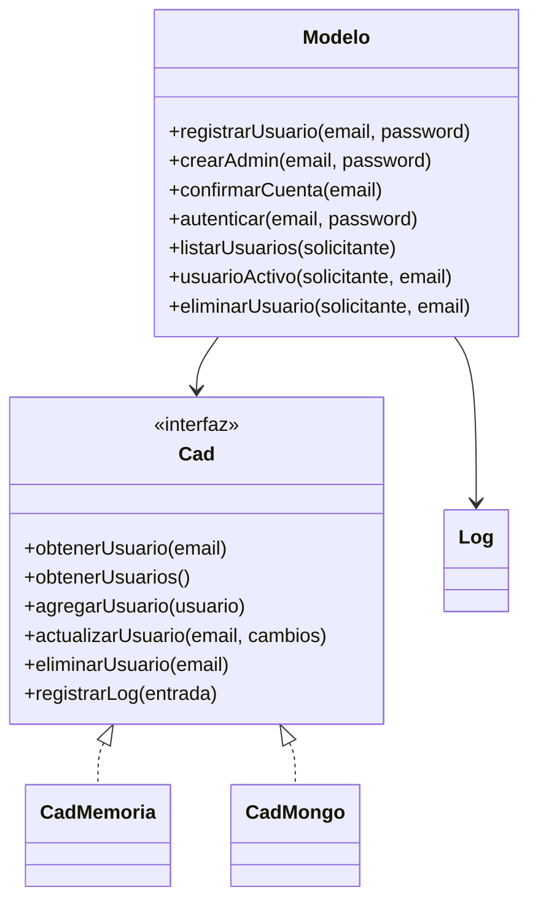
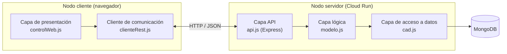

# ProcesosSW

Aplicación tipo SaaS con arquitectura en capas y gestión de usuarios (Sprint 1).
El backend sirve el frontend y toda la lógica de negocio y el acceso a datos
residen en el servidor; el cliente solo se comunica mediante una API REST.

## Tecnologías y justificación

| Tecnología | Para qué | Por qué |
| --- | --- | --- |
| Node.js + Express | Backend y API REST | Mismo lenguaje (JavaScript) en cliente y servidor; Express es minimalista y muy extendido. |
| MongoDB + Mongoose | Base de datos | Base de datos real (los datos sobreviven a un reinicio); Mongoose facilita el modelado y la capa de acceso a datos. |
| express-session | Sesión de usuario | Sesión en el servidor con cookie; el cierre de sesión es inmediato y muy fácil de explicar. |
| bcryptjs | Hash de contraseñas | Nunca se guarda la contraseña en claro; bcryptjs es puro JavaScript (sin compilación nativa). |
| Bootstrap 4 + jQuery | Interfaz de cliente | Interfaz responsive y llamadas AJAX sencillas; el foco del proyecto es la arquitectura, no el diseño. |
| Jasmine | Pruebas unitarias | Framework de pruebas automatizadas; las pruebas de la capa lógica no necesitan base de datos. |
| GitHub Actions | CI/CD | Integración y despliegue continuos documentados y versionados en el propio repositorio. |
| Google Cloud Run | Despliegue | Capa gratuita y URL pública; el backend escucha en `PORT`. |

## Arquitectura

Cuatro capas claramente separadas en archivos distintos. La frontera entre capas
es el punto donde se puede evaluar el proyecto: la capa lógica no sabe si los
datos están en memoria o en Mongo; solo conoce la interfaz de la CAD.





## Estructura

```
index.js                       Punto de entrada: arranque, sesión y semilla del admin
servidor/
  api.js                       Capa API (rutas REST + control de sesión y rol)
  modelo.js                    Capa lógica (reglas de negocio)
  seguridad.js                 Hash de contraseñas (bcryptjs)
  log.js                       Registro de actividad
  cad.js                       Selección de la CAD (Mongo o memoria)
  cadMongo.js                  CAD contra MongoDB (Mongoose)
  cadMemoria.js                CAD en memoria (pruebas y desarrollo)
  modeloSpec.js                Pruebas unitarias de la capa lógica
cliente/
  index.html                   Página única (SPA)
  clienteRest.js               Capa de comunicación (AJAX)
  controlWeb.js                Capa de presentación (GUI)
.github/workflows/            CI (ci.yml) y CD (deploy.yml)
spec/support/jasmine.json      Configuración de Jasmine
.env.example                   Nombres de las variables de entorno (sin valores)
```

## Puesta en marcha en local

Requisitos: Node.js 20+ y una base de datos MongoDB (Atlas, capa gratuita M0, o una
instancia local).

```bash
npm install
cp .env.example .env      # y rellena los valores
npm start                 # http://localhost:3000
```

Si no defines `MONGODB_URI`, la aplicación arranca con la CAD **en memoria**
(los datos no persisten). Es cómodo para una prueba rápida, pero para cumplir el
requisito de persistencia hay que configurar MongoDB.

## Variables de entorno

Los nombres (sin valores) están en `.env.example`. En Cloud Run se configuran en
el propio servicio; nunca se suben al repositorio.

| Variable | Descripción |
| --- | --- |
| `PORT` | Puerto del servidor (Cloud Run lo inyecta). |
| `MONGODB_URI` | Cadena de conexión a MongoDB. |
| `SESSION_SECRET` | Secreto para firmar la cookie de sesión. |
| `ADMIN_EMAIL` | Email del administrador inicial (semilla al arrancar). |
| `ADMIN_PASSWORD` | Contraseña del administrador inicial. |
| `NODE_ENV` | `production` activa cookies seguras (HTTPS). |

## Pruebas

```bash
npm test
```

Ejecuta las pruebas unitarias de la capa lógica con Jasmine. Usan la CAD en
memoria, así que **no necesitan base de datos ni conexión de red**. Incluyen
casos de error (email duplicado, cuenta pendiente, contraseña incorrecta, un
usuario normal intentando eliminar a otro, etc.).

## API REST

| Método | Ruta | Acceso | Devuelve |
| --- | --- | --- | --- |
| POST | `/api/registro` | público | Crea la cuenta en estado `pendiente`. |
| POST | `/api/confirmarCuenta` | público | Confirma la cuenta (en el Hito 4 lo hará el correo). |
| POST | `/api/login` | público | Inicia sesión y abre la sesión (cookie). |
| POST | `/api/logout` | sesión | Cierra la sesión. |
| GET | `/api/sesion` | — | Usuario de la sesión actual (mantener sesión al recargar). |
| GET | `/api/usuarios` | administrador | Lista con email, rol y estado. |
| GET | `/api/usuarioActivo/:email` | administrador | `{"activo":true|false}`. |
| DELETE | `/api/usuario/:email` | admin o uno mismo | Elimina la cuenta. |

## Acceso como administrador

El primer administrador se crea automáticamente al arrancar a partir de
`ADMIN_EMAIL` y `ADMIN_PASSWORD`. Para la revisión, las credenciales de prueba se
envían junto con la entrega (no se publican en el repositorio).

## Flujo de trabajo y CI/CD

- **GitHub Flow:** cada cambio se desarrolla en su propia rama y se integra en
  `main` mediante un pull request (aunque lo revise el propio autor).
- **CI** (`.github/workflows/ci.yml`): en cada push y pull request ejecuta
  `npm ci` y `npm test`. No se integra un PR con el CI en rojo.
- **CD** (`.github/workflows/deploy.yml`): cada push a `main` despliega
  automáticamente en Cloud Run. No se despliega a mano.

### Configuración del despliegue en Cloud Run (una sola vez)

El despliegue lo realiza el workflow `deploy.yml` en cada push a `main`. Solo
necesita que existan estos **secretos** en el repositorio
(Settings → Secrets and variables → Actions → New repository secret):

| Secreto | Contenido |
| --- | --- |
| `GCP_SA_KEY` | Clave JSON de la cuenta de servicio de Google Cloud. |
| `MONGODB_URI` | Cadena de conexión a MongoDB. |
| `SESSION_SECRET` | Secreto para firmar la cookie de sesión. |
| `ADMIN_EMAIL` | Email del administrador inicial. |
| `ADMIN_PASSWORD` | Contraseña del administrador inicial. |

Mientras falte alguno de ellos, el paso de despliegue se **omite** (el workflow
queda en verde) y la aplicación no se publica.

Preparación en Google Cloud (con `gcloud` autenticado y facturación activada):

```bash
PROYECTO=mi-proyecto-gcp
gcloud config set project "$PROYECTO"
gcloud services enable run.googleapis.com cloudbuild.googleapis.com artifactregistry.googleapis.com

# Cuenta de servicio que usará GitHub Actions
gcloud iam service-accounts create github-deploy --display-name="GitHub Actions"

# Permisos necesarios para desplegar
for ROL in roles/run.admin roles/artifactregistry.admin roles/cloudbuild.builds.editor roles/iam.serviceAccountUser; do
  gcloud projects add-iam-policy-binding "$PROYECTO" \
    --member="serviceAccount:github-deploy@$PROYECTO.iam.gserviceaccount.com" \
    --role="$ROL"
done

# Clave JSON: su contenido se pega en el secreto GCP_SA_KEY
gcloud iam service-accounts keys create clave.json \
  --iam-account="github-deploy@$PROYECTO.iam.gserviceaccount.com"
```

A partir de ahí, cada push a `main` crea o actualiza el servicio `procesossw`
en la región `europe-west1`, inyecta las variables de entorno desde los secretos
y devuelve la URL pública en el resumen del workflow.

## Estado de los hitos

- **Hito 1 — Esqueleto y backend**
  - [x] Capa lógica de gestión de usuarios (en memoria y en MongoDB) y pruebas unitarias.
  - [x] API REST que expone la lógica.
  - [x] CI (`ci.yml`) y CD (`deploy.yml`) incluidos en el repositorio.
  - [x] Flujo de ramas y pull requests (GitHub Flow) reflejado en el historial.
  - [ ] Despliegue activo (a falta de configurar los secretos de GCP en el repositorio).
- **Hito 2 — Frontend y sesión**
  - [x] Interfaz y capa de comunicación separadas.
  - [x] Registro e inicio de sesión locales con contraseña hasheada.
  - [x] Cierre de sesión y mantenimiento de la sesión entre recargas.
  - [x] Rutas protegidas que rechazan peticiones sin sesión válida.
- **Hito 3 — Persistencia y roles**
  - [x] CAD contra MongoDB (los datos sobreviven a un reinicio).
  - [x] Secretos en variables de entorno (`.env.example`).
  - [x] Roles usuario/administrador con restricciones aplicadas en el servidor.
  - [x] Registro (log) de la actividad relevante.

Pendiente para el Hito 4: inicio de sesión con proveedor externo (OAuth) y
confirmación de cuenta por correo electrónico.

## Notas de seguridad

- Las contraseñas se almacenan con hash bcrypt (nunca en claro ni cifrado reversible).
- Las restricciones de rol y de sesión se aplican en el servidor, no solo ocultando botones.
- El servidor sirve únicamente la carpeta `cliente/`; nunca expone `servidor/` ni `.env`.
